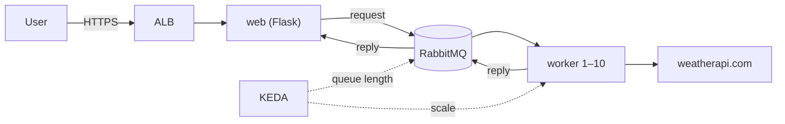

# Elistra Home Task
Two parts - jenkins jobs and weather app on k8s with queue service

| Part | What | Status |
|---|---|---|
| **A** | Jenkins jobs created with **Job DSL**: build, scan and push a Flask app and an Nginx reverse proxy, then deploy and verify them | ✅ |
| **B** | Weather app on **EKS** with a **RabbitMQ** queue, autoscaled by **KEDA** on queue length | ✅ **https://weather.tomerbahar.click** |

Everything runs on AWS, built with Terraform (official modules) and Packer.

```
infra/core/     Terraform: VPC, Jenkins controller, agent prerequisites
infra/packer/   Packer: golden AMI for Jenkins agents
infra/eks/      Terraform: EKS + add-ons (ALB controller, ExternalDNS, cert-manager, KEDA)
jenkins/        Part A: seed.groovy, Jenkinsfiles, flask-app, nginx-proxy, deploy
weather/        Part B: app (web + worker), k8s manifests
```

## Infrastructure
- **Private by default:** Jenkins and EKS nodes run in private subnets. Only the ALB is public, and Jenkins is reached over **SSM port forwarding**, with no open ports.
- **No access keys:** Terraform uses the local AWS CLI profile, EC2 instances use instance profiles, and pods use **EKS Pod Identity**.
- **Jenkins:** `jenkins_home` lives on a separate EBS volume, so it survives a replaced instance. Agents are **launched on demand** by the EC2 plugin from a **Packer AMI** and terminated when idle.
- **State:** stored in S3 with native locking. `core` and `eks` keep separate states.

## Part A – Jenkins
`jenkins/seed.groovy` (**Job DSL**) creates three pipeline jobs, each running its own Jenkinsfile from this repo:

| Job | What it does |
|---|---|
| `01-build-flask` | Build the Flask image → **Trivy scan** → push to Docker Hub |
| `02-build-nginx` | Build the Nginx image → **Trivy scan** → push to Docker Hub |
| `03-deploy-verify` | Run both with Docker Compose → verify → clean up |

- **Flask app:** lists the running containers. It reaches Docker through a **[docker-socket-proxy](https://github.com/Tecnativa/docker-socket-proxy)** that only allows listing containers, instead of mounting `docker.sock`, which would give it root-level access.
- **Nginx:** `FROM nginx:1.30.5-alpine3.24`, plus `proxy_pass` to Flask and the source IP injected as `X-Real-IP` / `X-Forwarded-For`.
- **Deploy:** Nginx is published on **`127.0.0.1:8080` only**. The job checks that binding, `/health` through Nginx, and that the container list includes both apps.
- **Pipeline:** a critical CVE fails the build before the push. Images get **semver tags** from `VERSION` files, and a tag that already exists can't be pushed again. Job 3 deploys exact versions, never `latest`.

## Part B – Weather app on EKS



- **One image, two roles:** the **web** (`gunicorn app:app`) serves the page. The **worker** (`python worker.py`) calls the weather API. They are separate Deployments, so each scales on its own.
- **Request-reply:** the web publishes the lookup with `reply_to` and a `correlation_id`, then waits up to 30 seconds for the reply. Messages expire after that, so stale requests are dropped.
- **No lost requests:** a worker acks a message only after replying (`prefetch_count=1`). If a worker is scaled down mid-request, RabbitMQ redelivers the message.
- **RabbitMQ:** deployed with the official Cluster Operator, on a persistent EBS volume.
- **Ingress:** the AWS Load Balancer Controller creates the ALB (HTTPS with an ACM certificate), and ExternalDNS creates the Route 53 record.
- **KEDA:** scales the workers on queue length, targeting about 5 waiting messages per worker, between 1 and 10 workers, with a 30-second scale-down window.
- **Load test:** `load-test.yaml` runs 40 concurrent users for 2 minutes. It scaled the workers from **1 to 7**, and back to 1 once the queue drained.

## Getting started
**Prerequisites:** AWS CLI profile, Terraform ≥ 1.10, Packer, kubectl, an S3 state bucket, a Route 53 zone with an ACM certificate, Docker Hub, and a weatherapi.com key.

```bash
# Infrastructure
ssh-keygen -t rsa -b 4096 -m PEM -f ~/.ssh/elisra-jenkins-agent-rsa -N ""
cd infra/core   && terraform init && terraform apply     # copy terraform.tfvars.example first
cd ../packer    && packer init . && packer build -var-file=agent.pkrvars.hcl .
cd ../eks       && terraform init && terraform apply     # set domain_name
$(terraform output -raw kubeconfig_command)
```

**Jenkins:**
1. Open the UI: `terraform -chdir=infra/core output -raw jenkins_ui_command | bash`.
2. Install the **Amazon EC2** and **Job DSL** plugins.
3. Add the credentials `ec2-agent-key` and `dockerhub-creds`.
4. Add an EC2 cloud using the Packer AMI and the label `docker`.
5. Create `seed-job`, which runs `jenkins/seed.groovy`, then run the three jobs.

**Weather app:**
```bash
kubectl apply -f https://github.com/rabbitmq/cluster-operator/releases/download/v2.23.0/cluster-operator.yml
kubectl apply -f weather/k8s/00-namespace.yaml
kubectl create secret generic weather-api -n weather --from-literal=API_WEATHER='<key>'
kubectl apply -f weather/k8s/
kubectl apply -f weather/k8s/load-test.yaml && kubectl get hpa -n weather -w   # load test
```

**Teardown:** first delete the Ingress, which removes the ALB and the DNS record. Then run `terraform destroy` in `infra/eks`, then in `infra/core`.

## Next steps
- Lint and unit tests, SCM polling triggers, JCasC, and a shared library for jobs 1 and 2.
- Build the weather image in Jenkins, add Argo CD for GitOps, Prometheus + Grafana, and WAF rate limiting on the ALB.